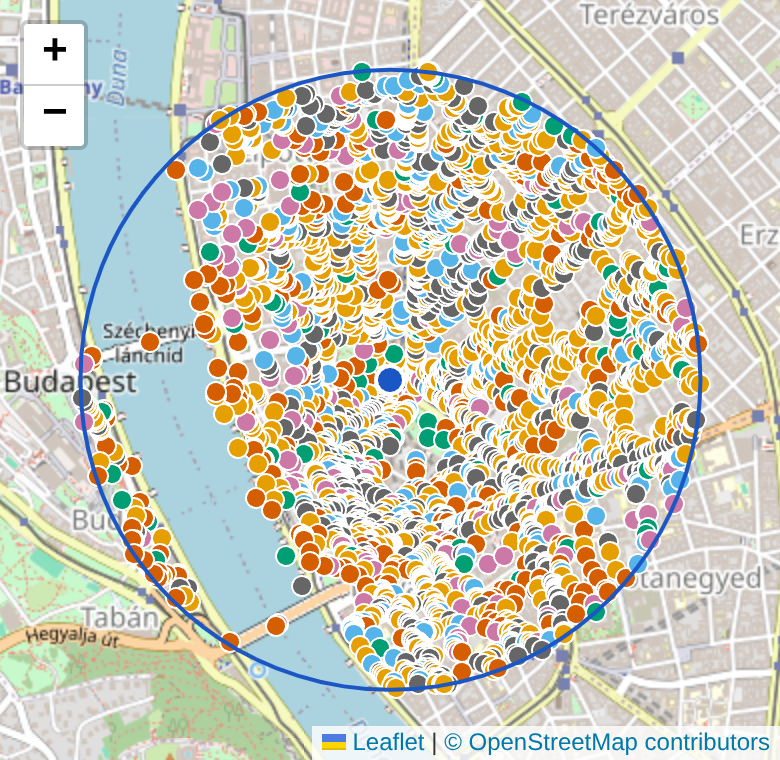
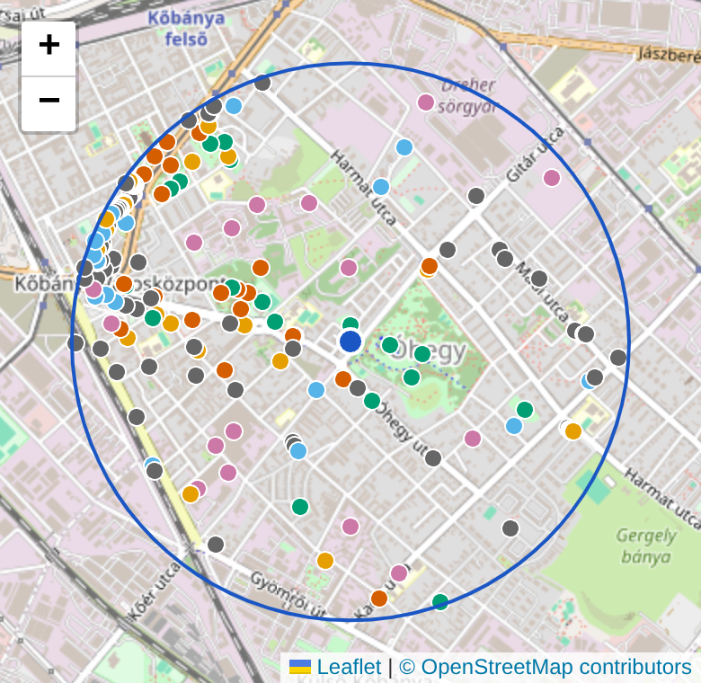

# super-board run: kilato, 2026-11-06

- **Config:** `.claude/super-board/configs/kilato.json`
- **Backend:** workflow · tier medium (sonnet/opus/session)
- **Target:** kornel-schrenk/kilato, base `develop`
- **Board:** Kilato board (#3): Backlog · Ready · Building · QA · Review · Blocked · Done
- **Started:** 2026-11-06T19:26:55Z, with 3 cards in Ready (#34, #48, #54), moved there on the product owner's word
- **Workers:** `max_workers` 0, so the planner sends every free card. Parallel again, after one card at a time from wave 14 of the first run
- **Resume:** `/super-board run kilato`

The first run is in [2026-11-03-kilato.md](2026-11-03-kilato.md). Its findings are in [findings.md](../findings.md).

## Before the run

- The product owner merged PRs #55 and #56, and asked to clean up, develop the three Backlog tickets, draft the message to the super-board author once the board is empty, and do the promotion at the end.
- Cleaned up: the four archived halt records, and two merged worktrees of the orchestrator's. The two stray `vite preview` servers from finding 37 had already gone, because the Pi rebooted at 20:15 CET.
- Licence card #57 created in Backlog from spec PR #55. The product owner moved it to Ready during wave 1 ("yes, move #57 to Ready"), so it joined wave 2.

## Cards

| Card | Lanes | Result | Column | Detail |
|---|---|---|---|---|
| #48 | build, qa, review | merged | Done | PR #58, `6a93b4a`, round 1. Truth 92, one reader's. The Reviewer filed #61 in Backlog |
| #54 | build, qa, review | merged | Done | PR #59, `1b88c4f`, round 1. Truth 94, one reader's. R1: `dataFolder` is exported with no importer, no ticket |
| #34 | build, qa, review | merged | Done | PR #60, `21953af`, round 1. Truth 88, one reader's. Two notes for the product owner, see below |
| #57 | build, qa, review | merged | Done | PR #62, `0539ecb`, round 1. Truth 90, one reader's. CI failed once on a flaky test the PR doesn't touch, see below. QA's M1: no test pins the licence's line breaks |

## Waves

| Wave | Cards | Merged | Bounced | Blocked | Failed | Agents | Tokens | Minutes |
|---|---|---|---|---|---|---|---|---|
| 1 | #34, #48, #54 | 3 | 0 | 0 | 0 | 13 | 1,640,353 | 145 |
| 2 | #57 | 1 | 0 | 0 | 0 | 5 | 786,992 | 169 |
| **Total** | 4 cards | 4 | 0 | 0 | 0 | 18 | 2,427,345 | 314 |

Lane times, in minutes:

| Card | Build | QA | Review |
|---|---|---|---|
| #34 | 47 | 57 | 19 |
| #48 | 22 | 22 | 15 |
| #54 | 23 | 48 | 19 |
| #57 | 33 | 89 | 46 |

## Finish

- **Board drained:** 2026-11-07, when #57 merged as `0539ecb`. Done: 22 cards, #5 to #21, #34, #48, #49, #54 and #57. Backlog: #61, which stays there on the product owner's word. Nothing in Ready, Building, QA, Review or Blocked.
- **State:** claims released, wave lock released, `max_workers` still 0, no worktrees left, no halt record. `develop` isn't live until the promotion PR merges.
- **Both runs together:** 22 cards, 26 waves, 155 agents, 26,414,550 agent tokens and 2,034 minutes of wave time, with 8 bounces, 4 blocks, 1 failed lane and 5 halts.

## Notes for the product owner

- **Flaky test, #65:** `e2e/outside.spec.ts:88` failed at `:101` (`.place` not visible) on PR #62's head, run 42314987956, and on docs-only `196b9e3`, run 42186117284. It passed 40 of 40 on the Pi, and no cause was found. PR #62's re-run passed, and the other run was never re-run. It can turn a good PR's CI red. Deploy runs no tests, so it can't stop a deploy.
- **Unsafe ports, #66:** `playwright.config.ts:5` picks a port from 4173 to 5172. The Fetch standard lists 4190, 5060 and 5061 as bad ports, and Chromium 156 refuses the last two. A run that draws one fails every page test with `net::ERR_UNSAFE_PORT`, about 2 runs in 1,000. PR #62's Reviewer hit 5060.

- **#34, AC4:** the Reviewer read "on screen" as position, as QA did: 83.6% of the 1 km circle's line is on the map at 375×667. The controls cover part of it, so a visitor sees 73.9% exploring and 78.1% following. At 360×640 the position figure is 75.6%. Reading it as visible takes a layout change and a new ticket. Decided: "position reading is fine", so it stays as merged.
- **#34, outside the ticket:** a search pick from the intro on a phone stays at zoom 15, with no circle on the map. The spec doesn't name this case, so no ticket was filed. Decided: "no ticket for the search pick".
- **#61 in Backlog:** "what counts as inside the box" is in two modules. No behaviour changes. Decided: "leave #61 in Backlog", so the board counts as empty without it.

## Evidence on the lane rule

Wave 1 was the first parallel wave under the rule from PR #53. Of 57 `gh` writes, 49 were plain and 8 were chained, 3 of those from #54's Builder, against 15 and 0 in the previous four waves. Wave 2 made 40 plain writes and 1 chained. None of the 98 was refused. These counts were corrected on 2026-11-07, as finding 47 explains. The one write that errored was a build lane's malformed GraphQL call, a 422 from GitHub.

So the chains passed 9 of 9, and the rule held unevenly. There's a confound too: at 20:31 CET, four minutes into wave 1, the product owner's `/auto-mode-setup` added a description of this repo as trusted to `~/.claude/settings.json`. The rule, that setting or chance could each explain the zero. This is finding 47.

## Promotion and first deploy

- **Merged:** PR #63, then PR #64 as `6055f0a`, by the product owner on 2026-11-07 at 07:03 UTC. The site is live at <https://kornel-schrenk.github.io/kilato/>.
- **Deploy:** passed first time in 1m44s, run 42349611842. The data build took 49 s and wrote 29,972 places, with 2,672 articles read. CI on `main` passed too, run 42349611848.
- **Live check:** Chromium 156 at 390×844 on the Pi, so not a real phone.

| Situation | Result |
|---|---|
| Located at Deák tér, in Hungarian | 100 rows on the first screen, first row after 3.6 s |
| Located at the Parliament, in English | Országház listed as "Parliament Building", "Open now", with a Wikipedia link. Tapping the row highlights it and opens the popup |
| Searching "Országház" | Finds it and four related places. `search.json` loads only for this: 2.8 MB, 713 KB compressed |
| Located in Vienna | Shows the outside notice |
| Hosts contacted | GitHub Pages and `tile.openstreetmap.org`, nothing else |
| Page errors | None. One console 404, almost certainly the missing favicon |

- **Density, finding 53:** places within 1 km are 2,846 at Deák tér, 1,721 at the Parliament and 160 at Kőbánya, counted from the live data files.

- **`develop`, finding 54:** deleted on GitHub 5 seconds after the merge, and restored by the product owner at `6743aca`.
- **Small, no ticket:** the page has no icon, hence the 404. Phones request up to 9 tiles at zoom 15 before moving to 14, because the map opens at 15 until it has a location (`src/ui/MapView.tsx:19`).
- **Not tested:** a real phone, other browsers, Deploy on a cached week, its `rebuild_data` option, and the weekly schedule, which first runs on Monday 2026-11-09 at 03:17 UTC.
- **Tickets:** #65 and #66 are in Backlog with #61, waiting for the product owner.
